# Name the Move

**100 motion-design moves to name in your next Opus 5.5 prompt.**

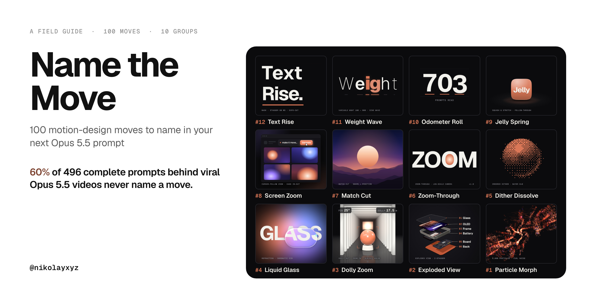

6 in 10 prompts behind viral Opus 5.5 videos never name a single move (a real one: “make a dynamic 15-second motion graphics video… go all out”), which leaves the motion up to the model. Name the move, and you tell it exactly what to animate. Here are 100 named moves in 10 groups, each with a one-line prompt; the 12 moves from the video come with a preview and a full copy-paste prompt.

**[Download the field guide (PDF, A4, 20 pages)](name-the-move.pdf)**

## How to use

In a snapshot of 703 prompts behind viral Opus 5.5 videos, 297 of 496 complete prompts (60%) name no move at all. Name it, and say how it plays:

**name the move** + **what moves** + **timing & easing** + **where it settles**

| | Prompt |
|---|---|
| **Before** | “make a dynamic 15-second motion graphics video that shows what an incredible motion designer you are, like it's your showreel… go all out.”<br><sub>A real prompt: 7 creators used this same opening line. No move named.</sub> |
| **After** | “**Text Rise**: split the headline into lines and letters; each line sits in its own mask and the letters rise from below it 60 ms apart, expo-out, settling sharp and straight.”<br><sub>The move, what moves, the timing and where it settles.</sub> |

Works in Claude Code with Remotion, HyperFrames or plain HTML + GSAP.

## The 12 from the video

In the order of the video, #12 to #1. Each preview is rendered in code; the full prompt spells out the same move.

### Text Rise

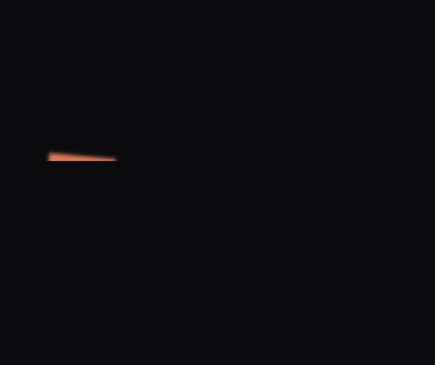

`#12 in the video` · Type & text · named in 5 of 703 viral prompts

```text
Text Rise: split the headline into lines and letters. Each line sits inside its own mask.
Letters rise from below the mask's bottom edge, 60 ms apart, expo-out (cubic-bezier(0.16, 1,
0.3, 1)), starting blurred and tilted 7° and settling sharp and straight. Under each white
letter an accent-colored copy rises 3 frames earlier, so a colored edge flashes on the way up.
Exit the same way, upward, out through the top of the mask.
```

### Weight Wave

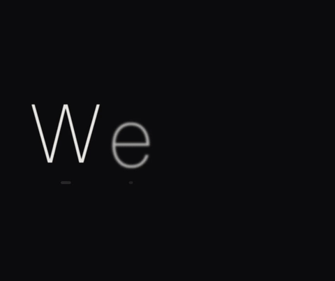

`#11 in the video` · Type & text · named in 0 of 703 viral prompts

```text
Weight Wave: set one word in a variable font and animate the wght axis letter by letter with a
traveling wave (100 → 900 → 100) that sweeps left to right one and a half times in 2 seconds.
Letters at the crest turn the accent color, get a soft glow and scale to 1.06. Put every letter
in a fixed-width cell so the word never changes width.
```

### Odometer Roll

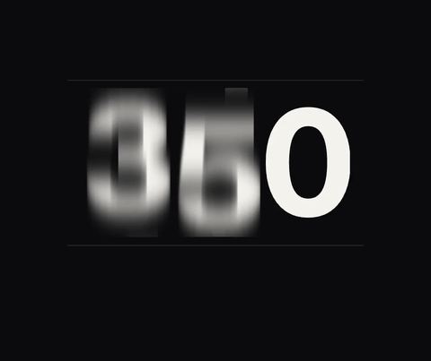

`#10 in the video` · Data & numbers · named in 2 of 703 viral prompts

```text
Odometer Roll: each digit is a vertical strip of 0–9 seen through a one-digit window. Spin the
strips 2–4 full turns and land on the target number, digits landing left to right 7 frames
apart, expo-out, with a 0.2-digit overshoot that settles. Blur each strip vertically in
proportion to its speed. Flash a short accent bar under each digit as it lands.
```

### Jelly Spring

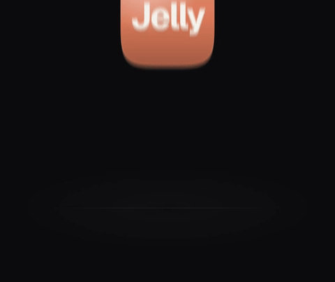

`#9 in the video` · Timing & physics · named in 4 of 703 viral prompts

```text
Jelly Spring: drop a rounded square onto a floor line under gravity. On impact squash it to 1.35
× 0.68 from the bottom edge (keep the area constant), stretch to 0.86 × 1.2 on the rebound, one
smaller bounce, then a damped jiggle to rest. The label on it follows 2–3 frames behind
(follow-through). Exit with an anticipation squash and a launch.
```

### Screen Zoom

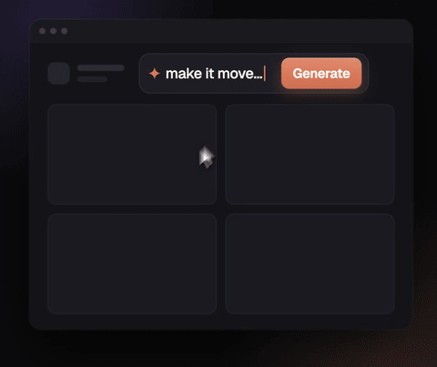

`#8 in the video` · UI & product · named in 10 of 703 viral prompts

```text
Screen Zoom: a UI window and a cursor moving on a curved path to the main button. The camera
follows the cursor and eases in to 1.9× (ease-in-out), with a 2-frame lag. On click: the cursor
dips to 0.9, the button presses to 0.96 and springs back, a ring ripples out, results stagger in
from the button, and the camera eases back out to show it all.
```

### Match Cut

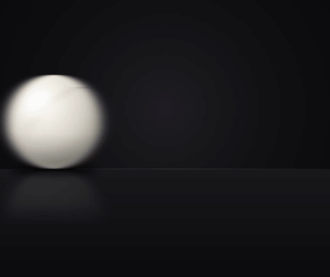

`#7 in the video` · Transitions & cuts · named in 2 of 703 viral prompts

```text
Match Cut: shot A ends with a white ball resting at the center of the frame. Hard cut to shot B,
where a circle of exactly the same size and position is the sun setting over layered mountains.
Keep the shape and position identical across the cut and change everything else. Keep one slow
camera push running through the cut.
```

### Zoom-Through

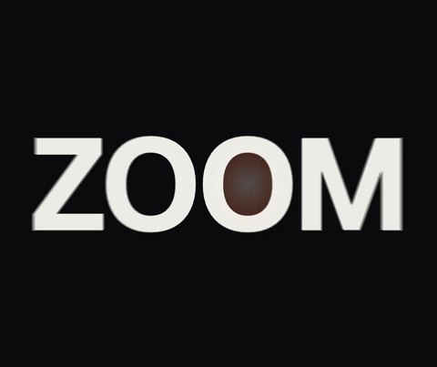

`#6 in the video` · Transitions & cuts · named in 3 of 703 viral prompts

```text
Zoom-Through: put the next scene inside the counter of the letter O, then dive the camera into
it. Scale in log space from 1× to 60× so the speed feels constant, keep the counter's center
gliding to the frame center, add radial zoom blur at peak speed, and let the inner scene grow
slower than the letter so you fly into it.
```

### Dither Dissolve

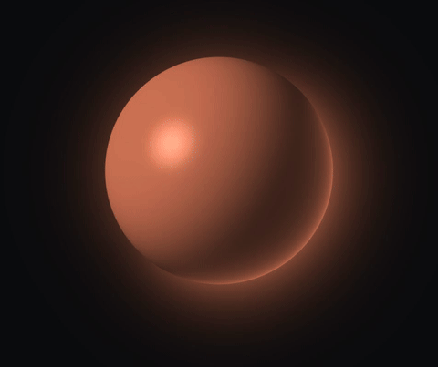

`#5 in the video` · Particles, fluids & shaders · named in 3 of 703 viral prompts

```text
Dither Dissolve: render a glossy orb, then convert it to a two-tone ordered Bayer 8×8 dither
with big 8 px cells, sweeping a diagonal front across it. Sweep the dither threshold out from
the center to dissolve the orb into the next shape, a dithered ring. Write it as a fragment
shader driven only by the frame number.
```

### Liquid Glass

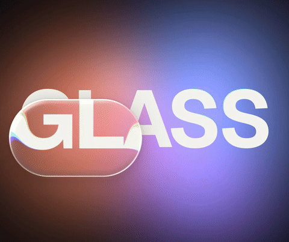

`#4 in the video` · Light, glass & materials · named in 4 of 703 viral prompts

```text
Liquid Glass: a pill-shaped glass lens (430 × 260, fully rounded) slides across bold type on a
slowly drifting mesh gradient. Inside the lens, magnify the background 1.15× and bend it toward
the rim using the rounded-rect SDF, sample R, G and B at slightly different offsets at the edge,
and add a top-left specular rim, an inner shadow and light frost.
```

### Dolly Zoom

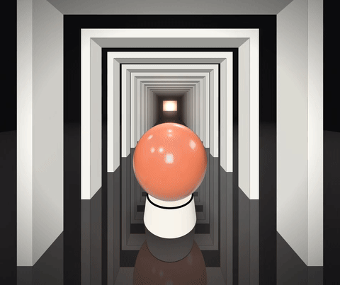

`#3 in the video` · Camera · named in 0 of 703 viral prompts

```text
Dolly Zoom: a glossy sphere on a pedestal in a long corridor of white gates fading into fog.
Pull the camera back while narrowing the field of view from 96° to 24°, so the sphere keeps
exactly the same size on screen (distance × tan(fov / 2) stays constant). The corridor stretches
behind it; the subject holds. End with a fast push in.
```

### Exploded View


`#2 in the video` · 3D & space · named in 8 of 703 viral prompts

```text
Exploded View: build a phone from six layers (glass, OLED, frame, battery, board, back). At a
3/4 angle, separate the layers along their normal with a 1.6-frame stagger, expo-out and a
slight fan rotation, then hold with thin leader lines and a numbered label on each layer. Snap
them back together with ease-in-out and flip the phone to its back.
```

### Particle Morph

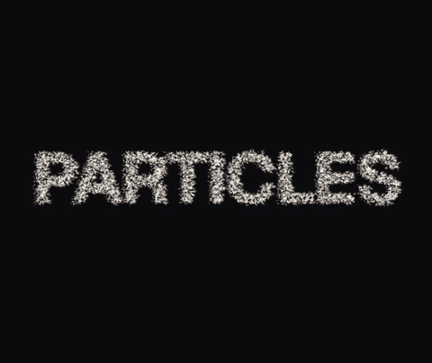

`#1 in the video` · Particles, fluids & shaders · named in 0 of 703 viral prompts

```text
Particle Morph: sample 8,000 points from a word drawn into an offscreen canvas. Tear the word
apart with a shockwave from the center, wind the particles into a two-armed spiral with curl
noise while their color shifts from white to the accent, then land them tile by tile into the
target layout (a 4 × 3 grid) and fuse each tile solid. Draw each particle as a streak along its
speed; every position is a pure function of the frame.
```

## The map: 100 moves

One-line starter prompts in 10 groups. ★ marks a move from the video, with its preview and full prompt above.

### 01 · Type & text

| Move | Prompt |
|---|---|
| **Text Rise** [★](#text-rise) | Split the headline into lines and letters; each line sits in its own mask and the letters rise from below it 60 ms apart, expo-out. |
| **Weight Wave** [★](#weight-wave) | Animate a variable font's weight axis letter by letter as a wave, 100 → 900 → 100, sweeping left to right; crest letters take the accent color. |
| **Typewriter** | Type the line character by character, about 30 ms per character, with a blinking block cursor that keeps blinking two beats after the last letter. |
| **Scramble Decode** | Each character cycles through random glyphs for 8–12 frames, then locks into the real letter, left to right. |
| **Kinetic Punch** | Hit one keyword per beat: scale it from 1.4 to 1 with a hard ease-out while the rest of the line holds still. |
| **Split-Flap** | Flip every letter like an airport board: the top half folds down over 4 frames, cycling 3–5 characters before landing on the target. |
| **Tracking Expand** | Start the word with tight letter-spacing (−0.1em) and ease it open to +0.02em over one second while it fades in. |
| **Word Stack** | Drop the words one by one into a tight left-aligned stack, 120 ms apart, each landing with a 6 px overshoot. |
| **Text on Path** | Run the caption along a curved SVG path and animate its start offset so the text slides along the curve and stops at the end. |
| **Blur Focus Type** | Letters start at 20 px blur and 120% scale, then sharpen to zero blur and 100% with a staggered ease-out. |

### 02 · Reveals & masks

| Move | Prompt |
|---|---|
| **Mask Wipe** | Reveal the image with a straight clip-path wipe at 15°, 0.6 s, ease-in-out, with a thin accent line riding the leading edge. |
| **Iris Open** | Open the scene from a circle that grows from the subject's center to the full frame, expo-out. |
| **Shape Reveal** | Reveal the next shot through a rounded-rect or logo-shaped mask that scales up past the frame edges. |
| **Line Draw** | Draw the outline with stroke-dashoffset from 0 to 100% in 0.8 s, then fade the fill in underneath. |
| **Split Reveal** | Slice the frame into six horizontal bands that slide apart in alternating directions to reveal what is behind. |
| **Spotlight Reveal** | Move a soft circular light across a dark frame so content appears only where it passes, then open it to full. |
| **Venetian Blinds** | Reveal through ten vertical slats that rotate open in a left-to-right stagger. |
| **Ink Bleed Reveal** | Reveal the image through an ink-blot mask that spreads from one point, with a noise-distorted organic edge. |
| **Counter-Scale Reveal** | Grow a small frame to full size while the photo inside eases from 130% down to 100%, so they move against each other. |
| **Gradient Wipe** | Dissolve to the next scene through a soft-edged wipe driven by a luminance map, darkest areas first. |

### 03 · Transitions & cuts

| Move | Prompt |
|---|---|
| **Match Cut** [★](#match-cut) | End shot A on a shape centered in frame; hard cut to shot B where a different object of exactly the same shape, size and position takes over. |
| **Zoom-Through** [★](#zoom-through) | Put the next scene inside the counter of a letter and dive the camera into it, scaling in log space from 1× to 60×. |
| **Whip Pan** | Swing the frame sideways with strong horizontal motion blur over 6 frames and land in the next scene moving the same way. |
| **Layered Wipe** | Sweep three color panels across the frame 3 frames apart; the last panel uncovers the next scene. |
| **Shape Morph** | Morph the main shape of scene A, a circle, into the main shape of scene B, a card, while everything else crossfades. |
| **Push Transition** | Let the new scene push the old one out of frame horizontally, both moving together on one ease-in-out with no gap. |
| **Glitch Cut** | Cut through 3–4 frames of RGB split, horizontal slice offsets and a brief flash, then snap to the clean shot. |
| **Light Leak Cut** | Hide the edit under an 8-frame warm light leak that washes across the frame. |
| **Cut on the Beat** | Place every cut exactly on a kick drum hit and hold each shot for a whole number of beats. |
| **Page Curl** | Turn the scene like a page, curling from the bottom-right corner with a soft shadow under the fold. |

### 04 · Camera

| Move | Prompt |
|---|---|
| **Dolly Zoom** [★](#dolly-zoom) | Pull the camera back while narrowing the field of view from 96° to 24°, so the subject holds its size and the background stretches. |
| **Slow Push-In** | Push in from 1.00 to 1.06 over the whole shot with a slight ease-in to build tension. |
| **Pull-Back Reveal** | Start on a detail that fills the frame and pull back to reveal it belongs to a much larger scene. |
| **Orbit** | Circle the camera 40° around the subject at a constant distance, ease-in-out, keeping it centered. |
| **Parallax Layers** | Split the scene into three depth layers and move them at 1×, 0.6× and 0.3× during a sideways camera slide. |
| **Crane Up** | Raise the camera from table height to top-down while tilting to keep the subject framed. |
| **Tracking Shot** | Follow the moving subject at a fixed offset while the background slides past with motion blur. |
| **Camera Shake** | On impact, shake the frame 8–12 px with decaying amplitude over 10 frames, plus 2 frames of blur. |
| **Rack Focus** | Shift focus from the foreground object to the background over half a second; the front blurs as the back sharpens. |
| **Handheld Drift** | Add slow noise of 2–3 px at about 0.3 Hz to camera position and rotation so it feels filmed. |

### 05 · Timing & physics

| Move | Prompt |
|---|---|
| **Jelly Spring** [★](#jelly-spring) | Drop it onto the floor: squash to 1.35 × 0.68 on impact, keeping the area, stretch on the rebound, then a damped jiggle to rest. |
| **Spring Overshoot** | Move elements on a spring (stiffness about 170, damping about 12) so they pass their target by roughly 8% and settle. |
| **Stagger Cascade** | Start the items 40 ms apart in reading order on the same ease-out, so the group arrives as a wave. |
| **Anticipation** | Before the main move, pull back 10% in the opposite direction for 4 frames, then launch. |
| **Follow-Through** | Let secondary parts such as a label, tail or shadow stop 2–4 frames after the main body and settle with a small wobble. |
| **Expo Ease-Out** | Use cubic-bezier(0.16, 1, 0.3, 1) for every entrance: fast start, long soft landing. |
| **Arc Motion** | Move objects along curved arcs instead of straight lines, peaking about 20% above the straight path. |
| **Speed Ramp** | Play the move at 2×, drop to 0.25× for the key moment, then ramp back up to 2×. |
| **Bounce Settle** | Drop it under gravity and let it bounce three times, each bounce 40% of the previous height. |
| **Hold on the Beat** | Freeze the composition for one beat after each big move so the eye can catch up. |

### 06 · Data & numbers

| Move | Prompt |
|---|---|
| **Odometer Roll** [★](#odometer-roll) | Make each digit a 0–9 strip in a one-digit window; spin 2–4 turns and land left to right with a small overshoot and vertical motion blur. |
| **Count-Up** | Count from 0 to the target on an ease-out so it slows into the final value, using tabular figures. |
| **Bar Race** | Grow the bars and re-sort them by value at every step, sliding each to its new rank over 0.4 s. |
| **Line Chart Draw** | Draw the line left to right with a glowing dot at its head, then fill the area under it at 20% opacity. |
| **Donut Fill** | Sweep the arc clockwise from 0 to the value, expo-out, while the percentage counts up in the center. |
| **Chart Morph** | Morph the bar chart into a line chart through shared data points. |
| **Tick Burst** | When the number lands, burst eight short lines outward from it and fade them within 10 frames. |
| **Data Points Pop** | Pop the scatter points in from zero scale on a spring, staggered by their x value. |
| **Heatmap Wave** | Light up the grid cells in a diagonal wave, each easing from transparent to its value color. |
| **Number Underline** | After the key figure lands, draw an accent underline under it left to right in 0.3 s. |

### 07 · UI & product

| Move | Prompt |
|---|---|
| **Screen Zoom** [★](#screen-zoom) | Let the camera follow the cursor and ease in to about 1.9× on the click, then ease back out when the result appears. |
| **Cursor Click** | Move a cursor on a curved path to the button; on click it dips to 0.9, the button presses to 0.96 and a ripple ring expands. |
| **Bento Assemble** | Fly the cards into a bento grid from scattered offsets with a stagger, then expand one card to full screen. |
| **Card Flip** | Flip the card 180° on the Y axis with perspective to show its back, with a shadow that shrinks mid-flip. |
| **Shared-Element Expand** | Grow the tapped thumbnail seamlessly into the full detail view, keeping its corners and image continuous. |
| **Device Slide-In** | Slide the phone mockup in from below with a 5° tilt that straightens as it lands. |
| **Notification Drop** | Drop a toast from the top with spring overshoot, hold it 1.5 s, then slide it back up. |
| **Typing in UI** | Type the prompt into the input field with a moving caret, then light up the send button. |
| **Hover Lift** | On hover, lift the card 8 px, grow its shadow and tilt it 3° toward the cursor. |
| **Skeleton to Content** | Show shimmering grey skeleton blocks, then crossfade each into its real content from top to bottom. |

### 08 · Light, glass & materials

| Move | Prompt |
|---|---|
| **Liquid Glass** [★](#liquid-glass) | Slide a glass pill over the type: magnify 1.15× inside, bend toward the rim, split RGB at the edge and add a top-left specular highlight. |
| **Light Sweep** | Pass a soft diagonal highlight across the logo or chrome type, left to right in 0.6 s. |
| **Glow Pulse** | Pulse the accent glow from 0 to 60% opacity and back on every beat. |
| **Lens Flare Pass** | Streak a lens flare across the frame as the light source crosses the center. |
| **God Rays** | Cast volumetric light rays from behind the subject and let them rotate slowly. |
| **Frosted Panel** | Slide a frosted-glass panel (20 px backdrop blur, white 10% fill, 1 px light border) over a moving gradient. |
| **Mesh Gradient Flow** | Drift four soft color blobs slowly behind the content to make a living mesh gradient. |
| **Chrome Reflection** | Map a moving environment reflection onto the type so it reads as polished metal. |
| **Neon Flicker** | Switch the neon on with three quick flickers before it holds steady, with a soft bloom. |
| **Grain & Vignette** | Add fine moving film grain at about 5% and a soft vignette to pull the frame together. |

### 09 · Particles, fluids & shaders

| Move | Prompt |
|---|---|
| **Particle Morph** [★](#particle-morph) | Sample 8,000 points from the word, burst them into a curl-noise swirl, then land them in the next shape. |
| **Dither Dissolve** [★](#dither-dissolve) | Render the scene through an ordered Bayer 8×8 dither with big cells, then sweep the threshold to dissolve into the next scene. |
| **Confetti Burst** | On success, burst 120 confetti pieces from the button with gravity, spin and air drag. |
| **Spark Trail** | Leave short-lived sparks behind the moving object that fade out over 12 frames. |
| **Metaball Goo** | Merge circles into blobby goo with a blur-plus-contrast filter so they pull apart like liquid. |
| **Ink in Water** | Spread colored ink from one point with fluid, curling edges, then let it settle. |
| **Halftone Pass** | Turn the image into a halftone dot pattern whose dot size follows brightness, then sweep back to the photo. |
| **Noise Displacement** | Warp the image with animated noise displacement that fades from strong to zero as it settles. |
| **Pixel Sort** | Smear the bright pixels downward in streaks for a melting, glitchy transition. |
| **Chromatic Hit** | On the beat, split the red and blue channels 6 px apart and snap them back over 4 frames. |

### 10 · 3D & space

| Move | Prompt |
|---|---|
| **Exploded View** [★](#exploded-view) | Split the product into its layers along Z with a stagger, label each layer with a leader line, then snap it back together. |
| **Turntable** | Rotate the product 360° on a slow ease-in-out under soft studio light with a contact shadow. |
| **Isometric Stack** | Tilt the UI screens into an isometric stack and fan them apart in depth. |
| **Assemble from Parts** | Fly the parts in from outside the frame and click them into place one by one with tiny impacts. |
| **Logo Extrude** | Extrude the flat logo into 3D depth while the camera swings 30° to show its side. |
| **Wireframe to Render** | Start the object as a wireframe, then wipe across it to the fully shaded render. |
| **Fly-Through** | Move the camera through a tunnel of objects at a constant speed with motion blur at the edges. |
| **Floating Objects** | Let the 3D objects bob slowly, ±4 px over a 3 s period, with tiny rotations so the scene feels alive. |
| **Shadow Sweep** | Move the light so the object's long shadow sweeps across the floor and reveals the text under it. |
| **Portal Reveal** | Open a circular portal in the scene and push the camera through it into the next world. |

## Notes

- 12 previews rendered in code by [@nikolayxyz](https://x.com/nikolayxyz); the other 88 prompts are starters, not render-tested.
- Previews built with Remotion, three.js and GLSL shaders. No stock footage and no frames from other people’s videos.
- The 12 were picked by hand for what polished motion work leans on, not by how often prompts ask for them.
- Method: 703 prompts from [github.com/yihui-dev/awesome-opus5-5-videos](https://github.com/yihui-dev/awesome-opus5-5-videos), snapshot 13 Oct 2026; 297 of 496 complete prompts name no move; labels by Claude Haiku, spot-checked.
- “Named in N of 703”: how many of the 703 prompts ask for the move by name (regex candidates, each one read by hand).

## Credits

Inspired by [@beamnxw](https://x.com/beamnxw)’s “600 motion design ideas”.

Free to use. Credit [@nikolayxyz](https://x.com/nikolayxyz).

The same guide as a PDF: [name-the-move.pdf](name-the-move.pdf) (A4, 20 pages).
